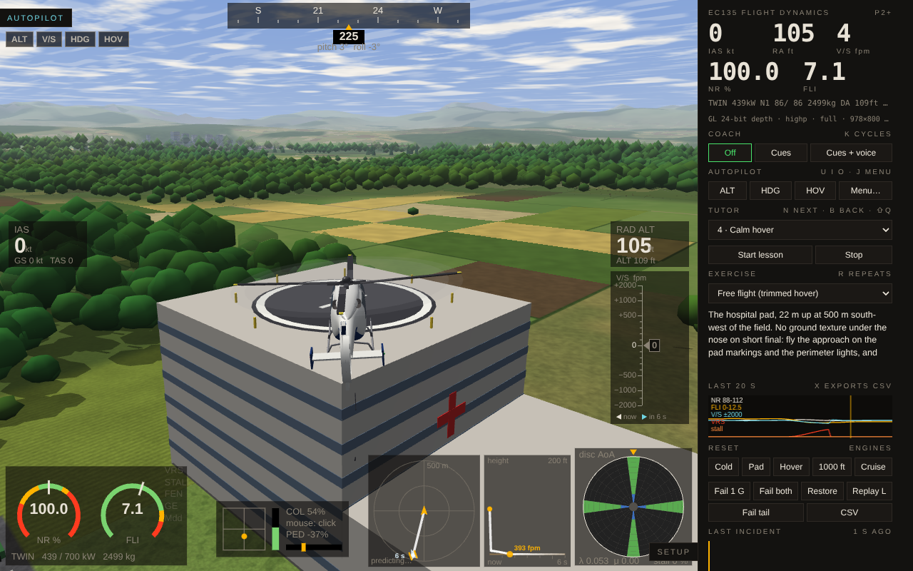
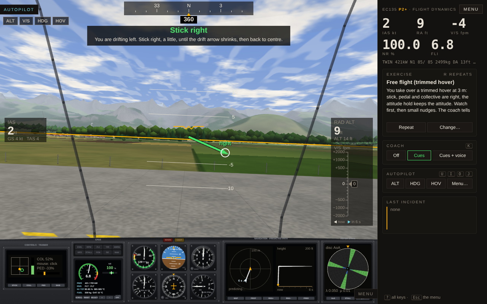
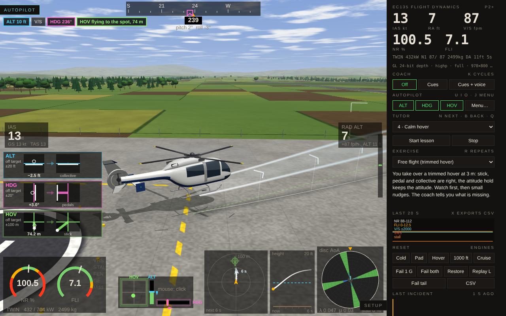

# EC135 Flight Dynamics

**Learn to hover and fly a helicopter, one step at a time, right in your browser.**



The hover is the first thing a helicopter pilot learns, and the hardest. Four controls act on each other, and the aircraft answers every input a little late: the stick tilts the rotor, the rotor tilts the fuselage, and only the speed that builds up moves you. If you watch your position, you react four seconds behind and start to oscillate.

EC135 Flight Dynamics teaches that chain one piece at a time. A tutor hands you the controls one by one, starting from a hover that stands still on its own. A coach in the left seat shows the correction you owe right now as an arrow on the screen, and a motion predictor draws where the aircraft will be in the next seconds. Underneath runs a real rotor model of the twin-engine EC135, measured against published data for the type.

It is a trainer, not a game, and not a certified flight training device.

**[▶ Fly it here](https://gitcrush.github.io/EC135-FlightDynamics/)**: desktop browser recommended, nothing to install. Click *Start the tutor – lesson 1*.

## Getting started

1. Open the [live page](https://gitcrush.github.io/EC135-FlightDynamics/) on a desktop browser.
2. Choose *Start the tutor – lesson 1*.
3. Click into the view: the mouse is captured as the cyclic stick (`Esc` releases it). `W`/`S` or the mouse wheel is the collective, `A`/`D` or the mouse buttons are the pedals.
4. If something feels hard, press `V`: the autopilot flies and you watch how small its inputs are. `V` again hands the aircraft back. To share the work instead, open the autopilot menu with `J` and let it fly the controls you are not practising.

## What you get

- **13 lessons** from a hands-off hover to the raw stick: first the collective, then the pedals, then the stick in five stages. Each step names one thing to do and checks itself.
- **A coach** that flies a shadow autopilot alongside you and shows the input it would add now, as arrows on the stick, collective and pedals, with one sentence naming the cause and the remedy. Spoken cues are optional.
- **An autopilot made to be watched**: height, vertical speed, heading, hover position or airspeed. It takes only the controls those need, shows its target and its hand on each, and gives a control back the moment you move it.
- **A motion predictor**: the real model flown ahead with your controls held, drawn as a band where the skids will go, with the touchdown coloured by the sink rate.
- **Click to fly**: hold `M`, click a spot on the ground, and the autopilot hover-taxis there while you watch every control it moves.
- **The EC135 P2+ instrument panel** in the cockpit, plus instruments that show the limits: rotor speed and power with their limits, a plan view of where you are going, and a map of the angle of attack over the whole rotor disc.
- **An incident detector** that names what went wrong (vortex ring, retreating blade stall, low rotor speed, Fenestron at its limit, dynamic rollover) together with the standard recovery.
- **A flight recorder**: the last 20 seconds as a strip chart that freezes after an incident and as a replay through the same instruments, a debrief card after every landing, and CSV export.
- **Exercises** beyond the tutor: cold start, autorotation, a hospital rooftop pad, a confined area, an engine failure in the hover and more. One or both engines, or the tail drive, can be failed at the press of a button.
- **Mouse, keyboard, gamepad or joystick**, with a setup panel that learns your controller from a single movement.

| The coach shows the correction you owe | Click to fly: the autopilot on its way to the spot, each mode showing what it corrects |
|---|---|
|  |  |

The simulator is the single file [`index.html`](index.html), served by GitHub Pages: no libraries, no assets, nothing loaded from anywhere else. You can open the [live page](https://gitcrush.github.io/EC135-FlightDynamics/) or download the file and open it locally.

---

## Under the hood

The rest of this page is for readers who want to know how it works. The aircraft is an EC135 P2+: 2.5 t, a bearingless four-blade rotor turning counterclockwise seen from above, a Fenestron tail and two turbines with FADEC.

**Tutor and coach.** The tutor hands over the stick in five stages: a calm hover hands-off, a tether that lets the aircraft tilt but not drift, one axis at a time, the stick as a velocity command with the help faded out, and finally the raw stick. Every airborne start begins in a hover trimmed to stand still hands-off, so you first learn what calm looks like. The coach (`K`) cycles through off, cues, and cues + voice. Cues are on by default; speech is opt-in, because browser voices vary a lot. Its sentence names rotor limits first.

**Exercises**: cold start, lift-off, pedal turns, quick stop, slope landing, a hospital rooftop pad, a confined area, autorotation, vortex ring recovery, an approach behind a phantom aircraft and an engine failure in the hover. Failures: one engine, both engines, and the tail drive (no anti-torque).

## Controls

| | Mouse (captured) | Keyboard | Gamepad |
|---|---|---|---|
| Cyclic (stick) | movement, starts at neutral | arrow keys | right stick |
| Collective | wheel | `W` / `S` | left stick vertical, triggers |
| Pedals | left / right button | `A` / `D` | left stick horizontal |
| Look around | hold middle button | hold `C` | |

`T` trim to the present attitude · `Shift` + arrows beep trim · `Y` back to the hover trim · `H` hover assist (stick = velocity) · `V` autopilot demonstration · `U` `I` `O` autopilot ALT, HOV/IAS, HDG · `M` (hold) click to fly · `J` autopilot menu · `K` coach off / cues / voice · `L` replay · `X` CSV export · `E` engines start/stop · `G` engine failure · `R` repeat the reset · `1 2 3` cockpit, chase, tower view · `F` flight path marker · `P` predicted path · `Space` pause · `N B Q` tutor next / back / quit · `?` key list.

A key is on or off, a hand is not, so each keyboard control has a pilot model: the collective is metered against the power and the rotor speed (and thrown down when the rotor droops or the engines quit), the pedal keys command a yaw rate with heading hold, and the arrow keys move the stick in two stages so that a tap stays fine. Real controls are analog; a gamepad or joystick is the bigger step. The setup has a **gamepad panel** that shows every axis and button live, learns each function from a single movement, and stores the mapping in the browser.

### Training aids

On by default, each can be switched off in the setup: **SAS** (rate damping with the trim fed forward), **attitude command** (a centred stick holds the trim attitude; fine around the centre, 28° pitch and 40° bank at the stops), **heading hold** (rate command and heading hold in the hover, turn coordination with a roll-axis heading hold above 45 kt) and **hover assist** (the stick commands a ground velocity). Two couplings a pilot's hands and feet take out are mixed in with the aids on: pedal with collective, and in the hover the roll attitude with collective.

**Autopilot modes** (free flight; `U` ALT, `I` HOV below 40 kt or IAS above, `O` HDG, V/S in the menu; `J` or the *Autopilot* tab at the top left opens the menu, the side panel has the same buttons). Like the automatic flight control system of the type, you engage what it should hold and it picks the control: ALT holds the height and V/S a climb or descent rate with the collective; HDG holds the heading with the pedals in the hover and with the bank (and the pedals for the ball) at speed; HOV holds the position over the ground with the cyclic below 40 kt; IAS the airspeed with the cyclic above. Every control no engaged mode needs is yours, and moving a control a mode drives gives it back to you, without a bump ("HOV off: you have the cyclic"). It is there to be watched: each mode has a colour (ALT and V/S cyan, HDG magenta, HOV and IAS green), and per engaged mode a lane at the left of the view shows, left to right, the deviation it works against and the correction it makes on its control (trim, present position, the trail of the last two seconds), lighting up while it corrects; its target also sits on its instrument (the heading bug, the hover spot on the ground and in the plan view) and its hand on the control indicator. The menu nudges the targets (height in 10 ft steps in the hover and 100 ft at speed, V/S in 100 fpm, heading in 10°, airspeed in 5 kt, the hover spot 5 m ahead, back, left or right).

**Click to fly** (hold `M`). A cursor appears (with the mouse captured as the stick, the mouse moves the cursor while the stick stays where it is), and under it the spot on the ground along the line of sight, or in the plan view, with its distance. A click there sends the autopilot: HOV flies to the spot as a hover taxi (up to 10 m/s, stopping at 0.6 m/s²) and holds it, ALT keeps the height above the ground there as it is here now, HDG turns the nose into the way when the spot is more than 25 m off. Its lanes at the left, its hand on the control indicator and the predicted path show what it does with every control on the way. Moving a control takes it back, as always. Below 40 kt and in the air; up to 2 km.

**Motion predictor** (`P` on/off, the horizon in the setup). It flies the real model ahead from the present state with your controls held where they are, the stability augmentation and the engaged autopilot modes working: 6 s in the hover, growing with the ground speed to 30 s from about 70 kt. In the view a band runs where the skids will run, its two bright edges the skids' tracks, tilted as the aircraft will be (it banks into a turn), with an arrow at every whole second (their spacing shows the speed); near the ground its shadow lies on the ground with a line down at every second. At speed, corner marks of a gate to fly through every 3 s, square to the path and banked: from the cockpit, where the band runs straight ahead into a point, they form a tunnel. Arrows and gates belong to moments, not to "so many seconds from now": they stay where they are in the world while the aircraft flies towards them, as markings on a road do, and a new prediction moves what is drawn smoothly over a sixth of a second instead of at once. Where the skids will touch, their footprint lies in the colour of the sink rate (green, amber, red from the hard-landing limit) with the time and the rate, and a red cross marks a crash. Next to the control indicator the plan view (nose up: the track flown, the track to come, an outline of the aircraft where it will be in 6 s, the hover spot, the ground speed) and the height profile over the same seconds (the skid height near the ground, the change of height higher up, the ALT target). The plan view works like a radar scope: it is not redrawn continuously; every 1.5 s a faint ping runs from the centre to the edge and replaces the picture where it passes, and between pings the picture stands, glowing down slowly, while the aircraft moves over it, so you can see whether it follows the path predicted at the last ping. The profile is renewed by the same ping, from now to the end.

Why it does not look further ahead in the hover: the path is exact for controls held still, and nobody holds them still. In the hover 1 % of stick moves the spot predicted for 6 s ahead by 0.5 m, for 10 s by 1.2 m and for 20 s by 4-5 m, so beyond ~8 s the path mostly shows corrections not yet made; in cruise the same 1 % makes 2.5-4 m after 20 s on a kilometre of track.

## What you see

Three views (`1` `2` `3`): cockpit, chase and tower.

**Cockpit view**: the view from the EC135's right seat over the glareshield, no frame in the way, and across the bottom the instrument panel of the P2+, flat and undistorted: straight ahead the flight instruments (airspeed, attitude, altitude; radar altitude, HSI, vertical speed) with master warning and caution, left of them the CPDS (warning unit with the trainer's limit lamps, the VEMD with FLI, rotor speed and the engine figures), and the trainer's displays as screens in the panel: control positions, the predictor's navigation display, the rotor state. Looking around (`C`) shows the view without the panel. Over it the HUD: heading tape, airspeed and radar altitude, a horizon and pitch ladder drawn with the scene's own projection, the flight path marker. Bottom left the lamps for vortex ring, stall, Fenestron limit, ground effect and drag divergence with the power line; in the chase and tower views also the rotor speed (NR) and the first limit indicator (FLI: 10 = maximum continuous, 11 = take-off power) as dials (in the cockpit the panel's engine display shows them). Bottom centre the stick, collective and pedal positions and the skid loads on the ground, and next to them the plan view and the height profile of the motion predictor (where the aircraft will be in the seconds ahead, the ground speed). Bottom right the rotor-state map.

**Side panel**: the large numbers, the coach, autopilot and tutor controls, the exercise brief, a 20-second strip chart of NR, FLI, vertical speed, vortex ring and stall, resets and engine failures, the last incident. After every landing a debrief card shows the touchdown rate, the power and rotor-speed band and the incidents.

The scene is drawn with WebGL and no libraries: an airfield with runway, taxiway, apron and pad markings, fields with crop rows and hedgerows, about 6,700 trees, a village, a lake, wind turbines that turn with the wind, a power line, a control tower, a hospital with a rooftop pad and a ridge on the horizon, under a cloud layer that drifts with the wind. Close to the ground the texture goes down to a few centimetres, and the rotor's downwash flattens the grass in moving rings, raises dust off ploughed fields and spray off the lake; the aircraft throws its real silhouette as a shadow. The view is drawn at the screen's own pixel density and always antialiased, and every pattern on the ground is filtered so that it does not shimmer. **Auto**, the default graphics setting, lowers the drawing resolution while frames come late and raises it again when there is room; **full** keeps it; **light** is for weak graphics hardware (simpler shaders, a thinner forest; same physics and cues). If the browser is not using the GPU at all, the side panel says so.

More screenshots are in [`docs/screenshots/`](docs/screenshots).

## Physics model

The model is a textbook rotorcraft model rather than a game-tuned flight model. It runs at 360 Hz (55 steps per rotor revolution) with a semi-implicit Euler integrator, and every mechanism is written down in the code with what it models and why.

**Main rotor** — blade-element model, time-marching per blade: four blades, eight elements each (denser towards the tip), every blade a rigid beam on an offset flap hinge. The flap equation comes from the Euler equation of the blade with the hub rotating at body rates, so rotor damping, the control phase, flapback with speed, the cross-coupling off nominal rotor speed and the hub moment that makes a hingeless rotor crisp all fall out of the same loop. Lift acts along the normal of the flapped blade, so the thrust tilts with the disc. Section aerodynamics with Mach-dependent stall and drag divergence, dynamic stall (a section pushed past its stall angle keeps its flow for a few chord lengths of travel and reattaches only below it), blade torsion under stall (the separated flow's pitching moment twists a stalled blade nose down, so a deep stall limits itself), tip loss, linear twist and flap/pitch coupling.

**Inflow** — Pitt-Peters dynamic inflow: a uniform state with apparent mass, the Glauert skew gradient and moment-driven gradient states. The vortex-ring region uses Leishman's empirical curve, joined to the model's own hover inflow, with seeded low-frequency roughness (periods of seconds, tens of percent of thrust) that peaks in the ring, and in the developed ring collective added beyond the entry value goes into recirculation instead of thrust (power settling); ground effect after Cheeseman and Bennett.

**Fenestron** — ducted-fan momentum theory with the axial flow through the duct: the fan carries about half the static thrust and the shroud the rest, the duct's ram drag damps yaw in the hover, the shroud's share fades with in-plane flow and does not work for reverse thrust, which the fan makes on its own disc; three blade elements with stall; the main-rotor wake at the tail. It takes its power from the main rotor, so at the power limit a pedal turn in the rotor's direction droops the rotor; in a fast left yaw the fan's own inflow can stall it, the unanticipated-yaw trap. A tail drive failure leaves the fin and the collective.

**Engines and rotor speed** — two turbines as power lags with acceleration limits, a FADEC governor with load feed-forward, ratings from the torque ratios of the EASA type certificate (take-off 5 min, maximum continuous; one engine inoperative 30 s, 2 min, continuous; only the absolute scale, 700 kW for twin take-off, is an estimate) with their time limits reported as incidents, rotor-speed limits from the same certificate (97–104 % power on, 85–106 % power off), a freewheel that lets the rotor autorotate, a start sequence with a run-up torque schedule, shutdown, fuel burn. Every rating scales with the smaller of the rotor speed and the turbine lapse k = 1.02 · δ · θ^−1.51, fitted to the published hover ceilings: the engines come out flat-rated to about sea level ISA, so there the gearbox limits and higher or hotter the turbines do. The airframe reacts the main-rotor mast torque, and a yaw acceleration speeds up or slows down the rotor until the governor catches it. The drive train loses 2.5 % in the gear meshes and drives the gearbox accessories; the generators sit on the engines and leave the rotor with them.

**Airframe and ground** — fuselage forces by the crossflow principle: each strip of cabin and tail boom feels only the flow across the body, so the boom drags sideways in a spin and through the rotor's downwash in the hover but not in straight flight; the cabin adds the side force and lift of a low-aspect-ratio body; destabilising fuselage moments that go as u·w and u·v (the yaw moment set to the EC135's measured derivative breakdown), rotor download, a stabiliser with the rotor-wake hump through transition, a cambered fin that carries most of the anti-torque in cruise (the Fenestron goes back toward zero thrust, as Airbus describes it) and keeps resisting beyond its stall. Four skid contact points and a tail bumper with anisotropic friction, so dynamic rollover, blade strike and tail strike are consequences, not scripts.

**Environment** — ISA with a temperature offset, wind with a boundary layer, Dryden-like turbulence and gusts; terrain from a deterministic noise that the renderer and the physics share, so a skid over a roof edge falls off it.

**Controls** — a 20 ms servo and linkage lag (it reproduces the published roll phase delay) and actuator rate limits.

**Control laws** — the aids above are written to be bumpless: every change of law (lift-off, switching an aid, the autopilot handing back, the tutor handing over an axis) starts from the stick the previous one left. The trim is measured for the current mass, CG and wind at every reset. In cruise the aids and the autopilot balance as a pilot does: the nose on the flight path at low speed, the ball centred from 80 kt. Light on the skids, the attitude command finds the hover attitude while the aircraft still pivots on its left skid, so it comes free without a sideways step.

Details, tables and the reasoning are in [`docs/TECHNICAL.md`](docs/TECHNICAL.md).

## Measured behaviour

From the test suites, 2500 kg, ISA, calm, release 2.3; the flight model has not changed since. The tag says how far a number can be trusted: **VAL** compared with a published figure the model was *not* tuned to; **CAL** a published figure a parameter was fitted to (agreement by construction, proves nothing about realism); **RULE** a published limit implemented as written; **KNOWN** an open deviation; untagged rows are plausibility checks against textbook ranges or estimates. Little of the model is validated against flight data: the published data for the type is thin, and most of it went into calibration. The broadest independent comparison is the [simulated flight test](#simulated-flight-test): 87 expectations written from sources by someone who never saw the model.

| Quantity | Model | Reference / expectation |
|---|---|---|
| Hover out of ground effect, 1000 ft | 422 kW (442 kW at the engines), FLI 7.2, blade pitch 9.5°, left pedal 38 % | ~55–65 % torque at this weight |
| Hover attitude | 3.1° nose up, 3.5° left skid low | left skid low for a counterclockwise rotor |
| Power in ground effect (skids at 0.3 m) | −12 % | Cheeseman–Bennett, 10–18 % |
| Level flight power: 60 / 100 / 120 / 135 kt | 236 / 324 / 436 / 559 kW | bucket at 55–70 kt |
| Anti-torque in balanced cruise, 120 kt | the fin and fuselage carry it, the Fenestron runs at zero thrust; pedal 0.83 right of the hover position | **CAL** Airbus IN 3540: the large fin takes the anti-torque in cruise, the pedal goes back to the zero-thrust position (fin camber set with it) |
| Directional derivatives at 90 kt by component | fuselage weathercock −0.25 m³/°; fin + Fenestron +0.58 m³/° and −1.09 1/s of yaw damping; total weathercock +0.33, dihedral −0.28 m³/° | **CAL** fuselage −0.26 (yaw moment volume set to it); **VAL** the rest against +0.51, −1.35, +0.25, −0.30 (Kampa et al. 1997, Fig. 18) |
| 137 kt at 2910 kg near sea level | needs maximum continuous power | **CAL** 137 kt cruise (frontal drag area fitted) |
| Climb, 2910 kg, sea level, 65 kt | 1490 fpm at MCP, 1790 at take-off power | **VAL, weak** ~1500 fpm published, power setting not stated |
| Hover ceiling out of ground effect, 2835 kg, flown | holds at 2685 m ISA and 1785 m ISA+20 at take-off power, NR 100 % | **CAL** EC135 P2 data (turbine lapse fitted) |
| Roll bandwidth and phase delay, 75 kt | 3.66 rad/s, 58 ms | **CAL** 3.7 rad/s, 55 ms (ERF 1997): servo lag fitted to it |
| Pitch bandwidth and phase delay, 75 kt | 3.01 rad/s, 70 ms | **KNOWN** 1.84 rad/s, 92 ms published: the model's short period is quicker and has less delay |
| Engine ratings | ratios exactly as in the type certificate, at every altitude and temperature | **RULE** TCDS EASA.R.009 |
| One engine inoperative, 2500 kg hover | held between OEI continuous and the 2-min rating (FLI 10.7); 2.5-min warning on time | **RULE** TCDS time limits |
| Steady vertical descent, 0.35–0.5 vh | induced velocity within 2 % of the empirical curve; same flow whatever the path | Leishman's curve (the ring's core itself is a model construct) |
| Hover with the controls fixed | slow oscillation, period 12 s, doubles in 5 s | slowly unstable, like every helicopter |
| Hover yaw damping | −0.56 1/s | **CAL** DLR identification, about −0.5 1/s |
| Dutch roll at 60 / 100 kt | 60 kt: 1.61 rad/s, damping ratio 0.23; 100 kt: period 2.7 s, damping ratio 0.24 (flown: 2.55 s) | **CAL** DLR identification at 60 kt, 1.80–1.86 rad/s (yaw inertia chosen with it); **VAL** its damping ratio 0.24–0.28 |
| Autorotation, 65 kt | 1990 fpm, NR 100 %, pedal 0.89 right with the ball centred, Fenestron −620 N | 1700–2200 fpm; **CAL** Airbus IN 3540: reverse Fenestron thrust near the right stop against the fin (right-stop pitch set with it) |
| Double engine failure at 40 kt, collective raised to the top | NR 69.9 % at 2 s, 60.8 % at 3 s | **CAL** Airbus simulation in AAIB AAR 3/2015: 69–71 %, ~61 % (rotor inertia fitted) |
| Autorotation flared at 80–110 ft | best touchdown 238 fpm (flare at 80 ft), NR peak 105.5 % | below the hard-landing limit, NR ≤ 106 % |
| Collective dump and pull in the hover | NR 99–102 %, settled in 6 s | FADEC holds 97–104 % |
| Vne 155 kt in a shallow descent | 10 % forward stick left, advancing tip Mach 0.84 | control margin at Vne |
| Retreating blade stall, 140 kt, aft cyclic held 2 s | stalls from ~1.23 g, peaks at 2.0 g, nose up 25–28°, rolls left 56° in 3 s and comes back | roll to the retreating side (left for this rotor) |
| Abrupt pull-up from 140 kt, 2910 kg | peak blade loading C_T/σ 0.175 at μ 0.31 (1.87 g) | **VAL** limit 0.176 at that advance ratio (Kampa 1997, Fig. 22) |
| Low g (0.10 g) | full roll control | hingeless rotor, no mast bumping |
| Vortex ring, developed (2500 kg) | collective only: 248 m lost, out after 18 s; classical 34 m; Vuichard 31 m; at the power limit collective alone does not get out; thrust fluctuates by ~19 % with periods of 2–6 s | collective alone deepens it; Vuichard least height; roughness 10–40 % (Johnson; amplitude set to it) |
| Tail drive failure | hover: 134 °/s nose right after 2 s; 100 kt: the fin holds the nose at 2° of sideslip; yaw lost below ~56 kt | run-on landing with speed (ERF 1997: fin designed for safe flight without tail thrust) |
| Engine failure in the hover, pedals still | nose yaws left at ~105 °/s | torque reaction gone (flight manual: "yawing motion nose left") |
| Full pedal from the hover, SAS off | left: 107 °/s after 1 s, 173 °/s after 3 s; right: 109 / 195 °/s | no published data found |
| Cold start to 100 % NR / rotor stop | 62 s / 141 s | about a minute to start; no published run-down time found |

Release 1.8 came out of an independent review of the model: a reviewer who had not written it checked the code against textbooks, the type certificate and the published data, then re-checked the fixes. It found and 1.8 fixes defects in the rotor (lift direction, the sign of an inflow gradient, tip loss), the yaw reaction, the engine ratings and the vortex ring; the re-check also caught the test labels overstating the validation, which the table above now states honestly. A mutation test checks that the suites notice a broken model. Details in [`docs/TECHNICAL.md`](docs/TECHNICAL.md#validation-18).

## Simulated flight test

No test pilot was available to judge the model, so release 1.8 simulates a flight test with three roles that never see each other's work ([`flighttest/`](flighttest)):

1. **Author.** Writes down from published sources only (textbooks, the FAA handbook, Airbus notices, the EASA type certificate, DLR system-identification papers) what a real EC135 does in 19 manoeuvres. The result is 87 expectations, each with a range, a source and a confidence. The cards are frozen (SHA-256 in `flighttest/cards.sha256`) before anything is flown.
2. **Test pilot.** `node flighttest/pilot.js` flies exactly those manoeuvres in the simulator and records them.
3. **Evaluator.** Sees the cards and the recordings but not the model, and judges each expectation PASS, NEAR or FAIL.

`node flighttest/report.js` turns the result into [`flighttest/report.html`](flighttest/report.html): plots, expectations and verdicts per card.

Four flights, each judged by a new evaluator who had seen neither the model nor the earlier verdicts:

| Flight | Release | PASS | NEAR | FAIL | Cards pass / mixed / fail |
|---|---|---|---|---|---|
| 1st | 1.8 | 66 | 13 | 8 | 11 / 6 / 2 |
| 2nd | 1.9 | 69 | 13 | 5 | 14 / 4 / 1 |
| 3rd | 2.1 | 74 | 8 | 5 | 14 / 4 / 1 |
| 4th | 2.2 | **75** | **7** | **5** | **14 / 4 / 1** |

Before anything was flown, the author found that the model's rotor turned the wrong way (fixed in 1.8). Between the flights the model changed, and some parameters were fitted to sources the cards also rely on; the report says which (fin camber and the Fenestron's right stop: Airbus IN 3540; rotor inertia: the AAIB's quote of an Airbus simulation; yaw inertia: the DLR Dutch roll; the fuselage's yaw moment: Kampa's derivative breakdown; the vortex-ring roughness amplitude). The third flight passed the Dutch roll at 100 kt, the pedal doublet and the power curve and brought the stall roll-off and the ball-centred sideslip to NEAR. The fourth flight changed no flight physics: the test pilot now flies the vortex-ring entry, the classical recovery and the autorotation exactly as the plan says, and it closes this iteration. Five expectations remain FAIL, none of them high-confidence:
- rotor-speed recovery after a power loss in the hover (red flag): with the pedals fixed the Fenestron keeps taking 16 kW, and the flat-pitch rotor only drives itself beyond ~1.9 vh of descent;
- the hover yaw decay after a pedal release (the governed rotor's inertia joins the yaw axis) and the yaw a sideways drift starts (through the Fenestron's inflow; the model's N_v is a third to a half of the BO 105's);
- the collective at 135 kt, 4° above the hover value (BO 105: ~3.4°);
- the sign of a 1 °/s yaw in the first half-second of a roll pulse at 100 kt (product of inertia).

Each has its measured reading in the report (marked as the developer's, in `flighttest/notes.json`) and in [`docs/TECHNICAL.md`](docs/TECHNICAL.md#fourth-flight-and-the-end-of-this-iteration-22). The cards stay frozen, so the same test can be flown again after every change.

## Sources and calibration

Rotor, controls, stabiliser and Fenestron data come from Kampa, Enenkl, Polz, Roth (Eurocopter Deutschland), *Aeromechanic Aspects in the Design of the EC135*, 23rd European Rotorcraft Forum, Dresden 1997 (ERF archive): rotor moment capacity of about 2000 Nm per degree of flapping, 10° twist, 7.5° flap/pitch coupling, cyclic ranges and stick travel, pitch and roll bandwidth, stabiliser and fin geometry, Fenestron geometry. The engine and rotor-speed limits follow the EASA type certificate (TCDS EASA.R.009, EC135 P2+), whose torque ratios set the ratings. The hover ceilings (EC135 P2 at 2835 kg: 2685 m ISA, 1785 m ISA+20, out of ground effect) come from a public type datasheet and calibrate the turbine lapse; the 137 kt cruise at maximum continuous power calibrates the frontal drag area; the roll phase delay (55 ms at 75 kt, ERF 1997) sets the servo lag. The published climb rate (~1500 fpm at MTOW, power setting not stated) is the only figure left over for an independent comparison. The vortex-ring recovery advice follows Airbus Helicopters Safety Information Notice 3463-S-00 (classical technique first; Vuichard, for this counterclockwise rotor right cyclic with left pedal, where there is no room ahead). The model form follows Seher-Weiß, *ACT/FHS System Identification Including Rotor and Engine Dynamics*, Journal of the American Helicopter Society 64, 2019 (DLR). Since 1.9 also fitted: the rotor polar inertia to the Airbus simulation of a double engine failure at 40 kt quoted by the AAIB (AAR 3/2015), the yaw inertia to the DLR Dutch roll at 60 kt, and the fin camber and the Fenestron's right-stop pitch to Airbus IN 3540 (the fin carries the anti-torque in cruise; the Fenestron needs negative thrust near the right stop in autorotation); since 2.1 the fuselage's destabilising yaw moment to the derivative breakdown in Kampa et al. 1997, Fig. 18, whose fin, Fenestron and total derivatives the model then matches without further fitting. Still estimates: roll and pitch inertia, the side and vertical drag areas, the blades' torsional stiffness and the separated-flow moment arm, the split of the longitudinal cyclic range, the absolute gearbox power, the Fenestron duct factor, pedal gearing and blade stall angle (16°, set so that the fan keeps a yaw-control margin at the hover ceiling), the dynamic-stall delay, and the strength of the power-settling term. The calibration table is in [`docs/TECHNICAL.md`](docs/TECHNICAL.md).

## Known limitations

- The aircraft data is partly estimated (see above). Calibrated to published figures: the hover ceilings, the 137 kt cruise, the roll bandwidth and phase delay, since 1.9 the rotor and yaw inertias, the fin camber and the vortex-ring roughness, and since 2.1 the fuselage's yaw moment and the Fenestron's right stop. Independently compared: since 2.1 the directional derivatives of fin and Fenestron and the Dutch-roll damping at 60 kt (they match), and the climb rate, weakly. Not certified against flight-test data.
- Open deviation: in pitch the model responds faster than published (bandwidth 3.0 against 1.84 rad/s at 75 kt). The yaw response has no published reference at all.
- Not to be trusted in absolute terms: yaw rates, vortex-ring height losses (the ring's core is a model construct after Johnson), one-engine margins (they hang on the estimated 700 kW scale), hover ceilings away from the two calibrated points.
- Open after the flight-test iteration (1.8–2.3): the pitch bandwidth (the model's short period is quicker and has less delay than the aircraft's; the stabiliser is ruled out, the missing delay has no source yet), and the roll-off in retreating blade stall is about 1.7 times the expected bank. The stall limit itself matches the published one (VAL since 2.3; until 2.2 the onset of local stall was compared with the limit load, two different things). Kept as physics, with no data to say otherwise: the hover yaw decay with the governed rotor, rotor speed after a hover power loss with the pedals fixed, the collective at 135 kt, and the rolls with the controls fixed that the cambered fin's yaw with speed starts.
- No flight model of the airframe's structural modes, no blade lag, no rotor icing, no weather beyond wind and turbulence.
- One aircraft, one area of about 3 × 3 km. No night lighting, no shadows from trees and buildings; the power line is visual only.
- The keyboard is a compromise: every key goes through a pilot model. A gamepad or joystick is recommended.
- Speech for the coach is off by default; it uses the browser's built-in voices, whose quality varies.
- In an embedded frame some browsers block the Gamepad API; the gamepad panel says so. Download the file and open it locally.

---

## Test harness

The physics and the browser code run headless in Node against DOM stubs; the browser build and the tests run byte-identical code. Every suite exits non-zero on failure and runs in CI on every push.

```
npm test                 # physics reference + qualities (fast) + tutor + handling
npm run qualities        # validation by class, modes, bandwidths (~4 min)
npm run scenarios        # scenario analysis, groups A to E
npm run mutation         # break the model 33 ways: does a suite notice? (hours on two cores)
npm run flighttest       # fly the frozen flight-test cards and rebuild the report
node test/controls.js    # open-loop control response audit
```

| Suite | What it checks |
|---|---|
| `test/consistency.js` | 80+ physics reference checks: hover trim, free response, governor, ground effect, power curve, climb, autorotation, vortex ring, control response, OEI, rotor-speed governing, crosswind, MTOW cruise, cold start, ground handling and dynamic rollover, determinism, invariants |
| `test/qualities.js` | every check labelled VAL / CAL / PHY / REG / KNOWN: the rotor in isolation, linear modes from eigenvalues (hover, 100 kt), ADS-33 bandwidth and phase delay by sine dwells against the published EC135 values, hover ceilings, climb and cruise, physical laws, the aids' mixing against the physics, type-certificate limits; golden values |
| `test/mutation.js` | 33 deliberate model errors run against `qualities` and `consistency`: a mutant no suite catches is a blind spot |
| `flighttest/pilot.js` | the simulated flight test: flies the 19 frozen cards, writes the recordings the evaluator judges |
| `test/tutor.js` | every one of the 48 tutor steps is passable by an ideal student, on the complete real code |
| `test/handling.js` | the human control path: keys, mouse and gamepad through the input models and control laws, the autopilot modes, the pilot taking a control back, the menu, the motion predictor against the flown path; jumps, swing-back, overshoot, asymmetry, wind-up, hand-overs, gamepad mapping and dead zone, blocked Gamepad API |
| `test/scenarios.js A\|B\|C\|D\|E` | signs and magnitudes in normal and limit manoeuvres: A yaw and pedals; B cyclic, blade stall, low g, Vne, quick stop, autorotation landings; C the aids in those manoeuvres; D main and tail rotor at the power limit, tail drive failure, weathercock, loss of yaw authority; E hover and cruise modes, transverse flow, vortex-ring recoveries |
| `test/browser.py` | headless Chromium smoke test (Playwright) |
| `test/uishot.py` | renders the screenshots in this README |

See [`test/README.md`](test/README.md).

## Building from source

The page is assembled from modules:

```
src/00_util.js … 70_pilot.js     physics, autopilot, trim and control laws (loaded by the tests)
src/80_input.js … 97_sound.js    input, rendering, motion predictor, HUD, autopilot modes and their display, coach, tutor, replay, UI, sound
html/template.html               layout and CSS
build.py                         concatenates src/*.js into the template → index.html
```

```
python3 build.py         # writes index.html
```

Edit `src/`, run `python3 build.py`, commit both. CI checks that `index.html` matches the sources.

## Deploying

GitHub Pages serves `index.html` from the repository root: *Settings → Pages → Build and deployment → Deploy from a branch → `main` / `(root)`*. The empty `.nojekyll` file keeps Pages from processing the repository. Any static host works the same way; the file has no external dependencies at all.

## Relation to Grenzbereich

This project transfers the approach of [Grenzbereich](https://github.com/GitCrush/grenzbereich), a rally vehicle-dynamics trainer, to a helicopter: textbook physics with every mechanism justified in the code, driver (here pilot) models for each input device, instruments that make the limit legible, an incident detector that names causes, and a headless harness that keeps the physics honest.

## Contributing

Physics changes are welcome when they come with a check in the harness and a rationale in the code. The comment style is deliberate: every mechanism states what it models, why it is there and what breaks without it. Handling changes need to keep `test/handling.js` and `test/scenarios.js` clean. Open work is listed in [TODO.md](TODO.md); good first topics are blade lag, tree and building shadows, wires as an obstacle, and touch controls.

## Licence and disclaimer

Apache License 2.0 — see [LICENSE](LICENSE) and [NOTICE](NOTICE).

This is an independent training and educational project. It is not affiliated with, endorsed by or derived from data of Airbus Helicopters; "EC135" refers to the helicopter type it models. It is not a certified flight training device and not a substitute for instruction or for the aircraft's flight manual.
